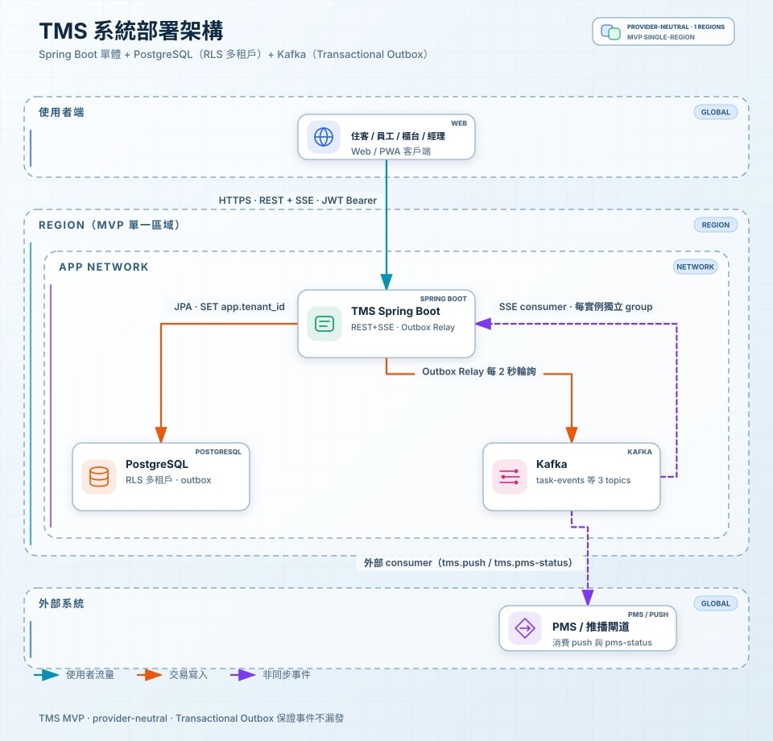
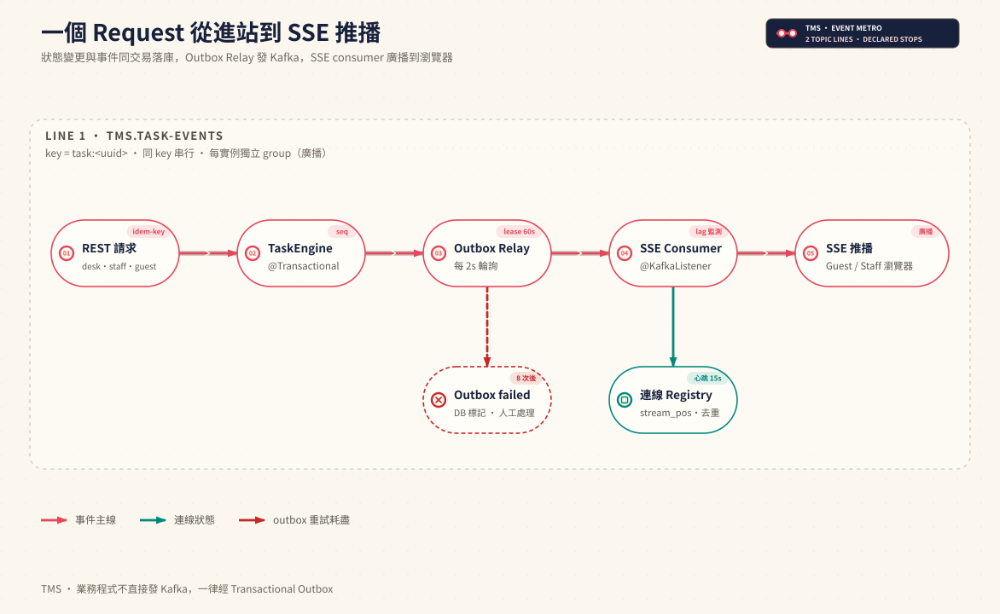

# TMS — 飯店任務交辦系統（MVP）

四五星飯店的任務交辦系統（Task Management System）。住客掃碼提需求、櫃檯判讀派單、
房務／工務從部門待接池搶單回報、主管查房把關、老闆看唯讀總覽。
雲端多租戶 SaaS 託管，PMS 用 adapter 模式介接（自家 PMS 是第一個 adapter）。

技術形態：**Spring Boot 模組化單體 + PostgreSQL（RLS 多租戶）+ Kafka（Transactional Outbox）**，
不做微服務。

## 架構圖

### 系統部署架構

Web / PWA 客戶端走 HTTPS（REST + SSE、JWT Bearer）進到 TMS Spring Boot 單體；
交易寫入 PostgreSQL（RLS 多租戶 + outbox 表），Outbox Relay 每 2 秒輪詢把事件轉送進
Kafka（task-events 等 3 個 topics）；應用自己也是 SSE consumer（每實例獨立 group 做廣播），
外部 consumer（PMS / 推播閘道）訂閱 `tms.push` 與 `tms.pms-status`。

### 一個 Request 從進站到 SSE 推播

事件主線：REST 請求（帶冪等鍵）→ TaskEngine（狀態變更與事件同一筆交易落庫，取 event_seq）→
Outbox Relay（每 2 秒輪詢、lease 60 秒；重試 8 次耗盡才標記 failed 交人工處理）→
SSE Consumer（@KafkaListener，監測 lag）→ 廣播到住客／員工瀏覽器。
連線層由 Registry 管 stream_pos 去重與 15 秒心跳。
業務程式不直接發 Kafka，一律經 Transactional Outbox。

## 文件導覽

這是文件先行的專案，完整文件索引（含線上 Artifact 連結）見 [INDEX.md](INDEX.md)。重點三份：

| 文件 | 內容 | 給誰看 |
|------|------|--------|
| `docs/11-requirements-architecture.html` | 需求規格與高階架構：五角色使用者故事、核心實體與 API、七個情境的高階設計、八題深入探討 | RD / PM |
| `docs/12-data-model.html` | 資料模型：17 張表逐欄位規格（型別、值域、鍵與索引、誰寫誰讀） | RD |
| `docs/13-poc/`（開 `index.html`） | 互動 POC「一房五幕」：住客／櫃檯／房務工務／主管／老闆五視角可操作原型 | Demo / PM / 老闆 |

本機 HTML 直接用瀏覽器開即可；13-poc 的跨分頁同步在 `file://` 下不可靠，
建議 `python3 -m http.server` 起本機伺服器再開。
