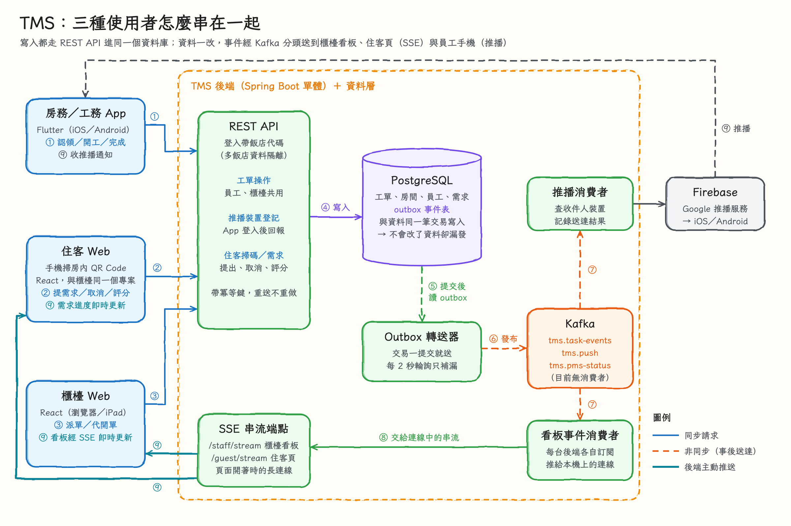
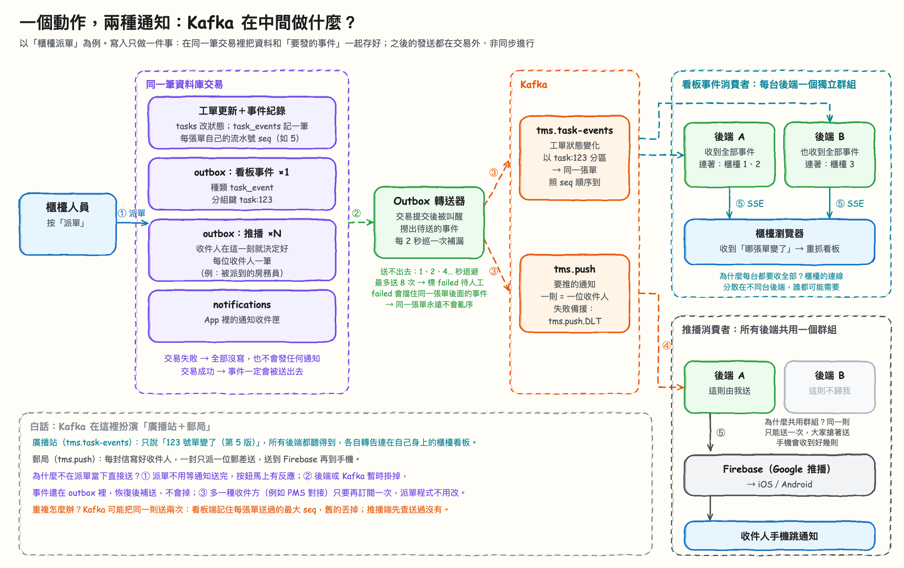
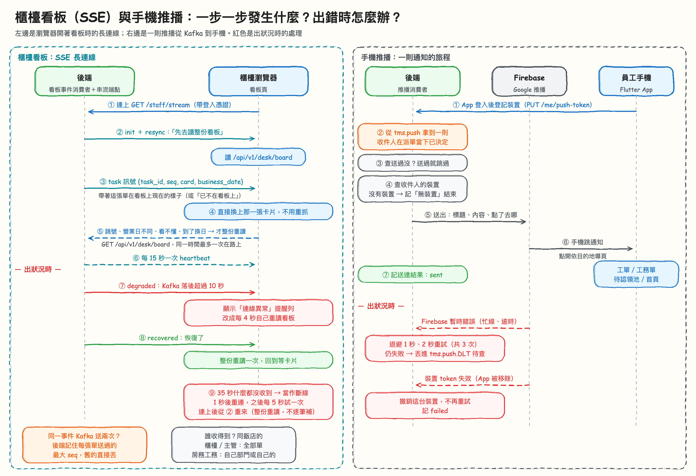

# TMS — 飯店任務交辦系統（MVP）

四五星飯店的任務交辦系統（Task Management System）。住客掃碼提需求、櫃檯判讀派單、
房務／工務從部門待接池認領回報、主管查房把關、老闆看唯讀總覽。
雲端多租戶 SaaS 託管，PMS 用 adapter 模式介接（自家 PMS 是第一個 adapter）。

技術形態：**Spring Boot 模組化單體 + PostgreSQL（RLS 多租戶）+ Kafka（Transactional Outbox）**，
不做微服務。程式碼分三塊：`tms/` 後端、`app/mobile/` 員工 App（Flutter）、`app/web/` 櫃檯 Web（React）；住客 Web 目前只有後端 API，前端尚未做。

## 架構圖：三種使用者怎麼串在一起？

系統有三種使用者端，但**寫入只有一條路**：全部走 REST API，寫進同一個 PostgreSQL。

| 使用者端 | 怎麼寫入 | 怎麼知道別人改了東西 |
|---|---|---|
| 房務／工務人員 App（Flutter） | REST API：認領、開工、完成 | 手機推播（Firebase） |
| 櫃檯人員 Web（React，瀏覽器／iPad） | REST API：派單、代開單 | 看板開著時維持一條 SSE 長連線（`/staff/stream`），即時更新 |
| 住客 Web（手機掃房內 QR Code，前端尚未做） | REST API：掃碼、提需求、取消、評分（後端已備） | 後端已備好 `/guest/stream`，等住客前端接上 |

把三者串起來的是「事件」：

1. **寫入時一併記下事件**：業務資料與一筆 outbox 事件在同一筆交易寫入，
   所以不會發生「資料改了、事件卻沒發」。寫入可帶冪等鍵（`Idempotency-Key`，派單、查房等端點必帶），網路重送會回放上次結果、不會重做。
2. **交易一提交就送進 Kafka**：Outbox 轉送器在交易提交後立刻發布；每 2 秒的輪詢只負責補漏，
   送不出去會退避重試，最多送 8 次仍失敗才標記 failed 交人工處理。
3. **Kafka 分頭送達**：
   - `tms.task-events` → 看板事件消費者（每台後端各自訂閱）→ 推給連在本機的櫃檯看板（SSE）。
   - `tms.push` → 推播消費者 → Firebase → 員工手機；暫時性失敗重試耗盡進 `tms.push.DLT`。
   - PMS 對接串流 `/integration/pms/stream` 也由看板事件消費者從 `tms.task-events` 轉推；
     另有 `tms.pms-status`（房態回寫事件）會寫出，但目前沒有消費者。

所以住客一提需求（住客前端接上後），櫃檯看板會立刻跳出來、負責人的手機也會收到推播；
員工在 App 按完成，櫃檯看板同樣即時更新。業務程式不直接發 Kafka，一律經 Transactional Outbox。

## 通知是怎麼送出去的？Kafka、SSE 與推播

以「櫃檯派單」為例：派單只在同一筆交易裡把工單和「要發的事件」一起存好，之後的發送都在交易外進行。
Kafka 在中間扮演兩個角色——**廣播站**（`tms.task-events`）只說「哪張單變了」，每台後端都聽得到，
各自轉告連在自己身上的櫃檯看板；**郵局**（`tms.push`）每則都寫好收件人，只派一台後端送到 Firebase 再到手機。

櫃檯看板收到的只是訊號，收到後自己重抓看板；連線出問題時改成每 5 秒自己重讀，重連後整份重讀。
推播則先查送過沒、查收件人的裝置，再交給 Firebase；暫時失敗會退避重試，仍失敗進 `tms.push.DLT` 待查。

## 文件導覽

這是文件先行的專案，完整文件索引（含線上 Artifact 連結）見 [INDEX.md](INDEX.md)。重點三份：

| 文件 | 內容 | 給誰看 |
|------|------|--------|
| `docs/11-requirements-architecture.html` | 需求規格與高階架構：五角色使用者故事、核心實體與 API、七個情境的高階設計、八題深入探討 | RD / PM |
| `docs/12-data-model.html` | 資料模型：17 張表逐欄位規格（型別、值域、鍵與索引、誰寫誰讀） | RD |
| `docs/13-poc/`（開 `index.html`） | 互動 POC「一房五幕」：住客／櫃檯／房務工務／主管／老闆五視角可操作原型 | Demo / PM / 老闆 |

本機 HTML 直接用瀏覽器開即可；13-poc 的跨分頁同步在 `file://` 下不可靠，
建議 `python3 -m http.server` 起本機伺服器再開。
