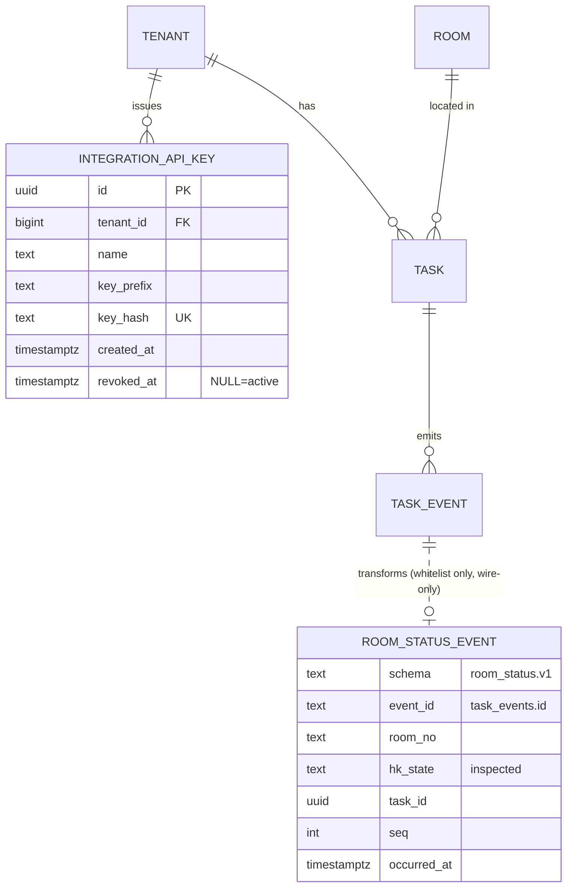

# data-model · pms-sse-integration

真源：`specify/spec.md`（STATUS: READY）。brownfield 需求：僅 1 個新持久化實體，
2 個既有實體唯讀消費，1 個 wire 契約（非持久化）。依複雜度比例原則採精簡形態。

## 1. 實體目錄

| 實體 | 分類 | 業務識別 | data-only | 新/既有 | 來源 |
|------|------|----------|-----------|---------|------|
| IntegrationApiKey | master | 代理鍵 id（uuid, UuidV7）；`key_hash` 全域唯一 | 否 | **新** | spec 節 4、FR-101/102/107 |
| TaskEvent | transactional（事件流水/history） | (tenant_id, task_id, seq) 唯一；id（bigint IDENTITY）兼整合 cursor | 本質即 history | 既有（唯讀） | spec 5.1、FR-202 |
| Room | master | (tenant_id, room_no) 唯一 | 否 | 既有（唯讀 join） | spec 節 4、FR-303 |
| RoomStatusEvent | wire 契約（**不持久化**） | event_id（=TaskEvent.id） | — | 新（僅形狀） | spec 5.1 D4 表、FR-001 |
| Tenant | master | id（bigint IDENTITY） | 否 | 既有 | FR-101 關係端點 |

## 2. 屬性

### IntegrationApiKey（唯一新實體）

| 屬性 | stored/derived | 必填 | 值種類/值域 | PII |
|------|----------------|------|-------------|-----|
| id | stored | ✓ | uuid（UuidV7 慣例） | 否 |
| tenant_id | stored | ✓ | bigint，FK → tenants | 否 |
| name | stored | ✓ | 文字（同租戶可重名，假設 A6） | 否 |
| key_prefix | stored | ✓ | 文字 16 字（明文前 16 字，僅對帳） | 否 |
| key_hash | stored | ✓ | 文字 64 字 hex = SHA-256(明文)；全域 UNIQUE | 否（不可逆） |
| created_at | stored | ✓ | timestamptz | 否 |
| revoked_at | stored | 可空 | timestamptz；非空=已撤銷（不可逆） | 否 |
| （active） | **derived** | — | 布林 = `revoked_at IS NULL`，不落欄 | 否 |

明文 key（`tmsik_<tenantId>_<43 字 base64url>`）**不是屬性**——僅開立當下存在，
不持久化（FR-102）。

### RoomStatusEvent（wire，全欄 derived 自 TaskEvent + Room）

| 欄位 | 來源 |
|------|------|
| schema | 常數 `room_status.v1` |
| event_id | TaskEvent.id（十進位字串） |
| room_no | Room.room_no（經 Task.room_id join） |
| hk_state | 白名單對映右值（v1：inspected） |
| task_id / seq / occurred_at | TaskEvent.task_id / seq / created_at |

### TaskEvent / Room / Tenant

既有實體，schema 零改動（spec 5.1「其餘維度不變」）。TaskEvent 新增的只是
**讀取樣式**：`id > :after AND created_at <= now()-3s AND type IN (白名單) ORDER BY id`。

## 3. 關係

| 關係 | 基數 | 存在性 | 刪除行為（業務語言） |
|------|------|--------|---------------------|
| Tenant —< IntegrationApiKey | 1:N | key 必屬一租戶 | 租戶不可刪（既有 RESTRICT 慣例）；key 不硬刪、以 revoked_at 停用 |
| TaskEvent →（轉換）RoomStatusEvent | 1:0..1 | 僅白名單 type 產生 | 不適用（wire 不持久化） |
| Task —< TaskEvent、Room ← Task | 既有 | 既有 | 既有，不變 |

## 4. 生命週期

**IntegrationApiKey**：`active`（revoked_at IS NULL）→ `revoked`（落印 revoked_at）。
單向、不可逆、不復活；歷史=撤銷列永久保留（稽核）。輪替=新 key active 與舊 key
重疊一段窗口後撤舊。

## 5. 關係圖

## 6. 覆蓋帳本（spec.md 名詞 → 歸類）

| spec.md 名詞 | 歸類 | 去向 |
|--------------|------|------|
| integration_api_keys / IntegrationApiKey | entity | 節 1/2 |
| API key 明文 / tmsik 格式 | 非屬性（瞬態值） | 節 2 註記 |
| key_hash / key_prefix / revoked_at / name | attribute | 節 2 |
| active / revoked | 狀態（derived） | 節 2、節 4 |
| 輪替 / 撤銷 / 重疊窗口 | 生命週期規則 | 節 4 |
| TaskEvent / task_events / cursor / event_id | entity（既有）＋ attribute | 節 1/2 |
| 3 秒安全遲滯 | 讀取樣式規則（非資料） | 節 2 TaskEvent 讀取樣式 |
| Room / room_no | entity（既有）/ attribute | 節 1/3 |
| RoomStatusEvent / room_status.v1 / schema | wire 契約 | 節 2 |
| hk_state（整合面） | enum（封閉，v1 單值 inspected） | 節 2 |
| 白名單對映 | 規則（enum 對映，程式常數） | 節 2 RoomStatusEvent 來源欄 |
| 去重鍵 (task_id, seq) | 既有唯一性（uq_task_events_task_seq） | 節 1 TaskEvent 識別 |
| ROLE_INTEGRATION / X-API-Key / filter / SecurityConfig | 行為層（非資料） | ignore → class_diagram/api |
| outbox / pms_status / OutboxKind / Kafka topic | 退場標的（非新資料） | ignore → db_table（V3 DELETE）＋ api/gherkin |
| events API / stream / SSE / limit / next_cursor | 行為/契約層 | ignore → api |
| degraded / 心跳 / StreamConnectionRegistry | 既有行為 | ignore → class_diagram |
| Tenant / tenant_id / RLS | entity（既有）＋隔離規則 | 節 1/3；RLS 細節 → db_table |
| inspections / rooms.hk_state 回寫 / push | 既有行為不變（FR-404） | ignore |

無「未處理」。

## 7. 詞彙表（精簡）

| 術語 | 定義 | 別名 |
|------|------|------|
| 整合 key | PMS 持有的 per-租戶 M2M 長效憑證 | API key、IntegrationApiKey |
| cursor | task_events.id 的十進位字串，PMS 的增量書籤 | after、event_id、Last-Event-ID |
| room_status | 對 PMS 外送的房況事件 wire 契約（v1） | RoomStatusEvent |
| 白名單對映 | task_events.type → 外流 hk_state 的封閉表 | 過濾規則 |
