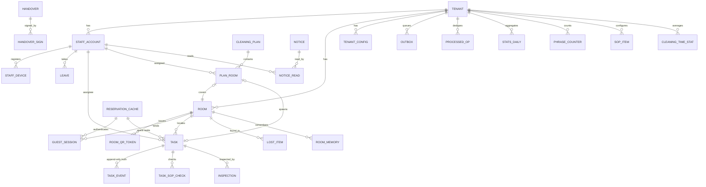

# TMS 資料模型（概念/邏輯層——實體集合唯一真相）

來源：`specify/spec.md`（STATUS: READY）。docs/12 已逐欄位的 17 張表照權威承載；
docs/12 §7 待補的 9 張表在本檔定案（標 ◆）。class_diagram 與 db_table 對齊本檔。

## 1. 實體目錄

| 實體 | 分類 | 業務識別 | data-only | 來源 |
|---|---|---|---|---|
| Tenant（tenants） | master | 代理鍵 bigint id（例外二） | — | spec §4、§5.1 |
| StaffAccount（staff_accounts） | master | (tenant_id, login_id) | — | 故事 5 |
| StaffDevice（staff_devices） | master | (tenant_id, staff_id, device_fingerprint) | — | FR-040 |
| Room（rooms） | master | (tenant_id, room_no) | — | 故事 1/4 |
| RoomQrToken（room_qr_tokens） | master | token 全域唯一；一房一枚 active | — | 故事 6 |
| GuestSession（guest_sessions） | transactional | session_token 全域唯一 | — | 故事 1/5 |
| ReservationCache（reservations_cache） | transactional（外部副本） | (tenant_id, reservation_ref) | — | 故事 9 |
| Task（tasks） | transactional（投影） | 代理鍵 UUIDv7 | — | 故事 1–4 |
| TaskEvent（task_events） | transactional | (tenant_id, task_id, seq)；PK bigint id | history（唯一真相） | GR-004 |
| Outbox（outbox） | transactional | (tenant_id, kind, idempotency_key)；PK bigint id | 轉運匣 | GR-003 |
| ProcessedOp（processed_ops） | transactional | PK (tenant_id, op_id) | 去重簿 | GR-002 |
| CleaningPlan（cleaning_plans） | transactional | 一班一份 published（partial unique） | — | 故事 7 |
| PlanRoom（plan_rooms） | transactional | (tenant_id, plan_id, room_id) | junction（Plan×Room×Staff） | 故事 7 |
| CleaningTimeStat（cleaning_time_stats） | 投影 | PK (tenant_id, room_type) | derived 表 | FR-100 |
| ◆ SopItem（sop_items） | reference | (tenant_id, item_key) | — | FR-013、故事 15 |
| ◆ TaskSopCheck（task_sop_checks） | transactional（投影） | (tenant_id, task_id, item_key) | — | FR-013 |
| ◆ Inspection（inspections） | transactional | 代理鍵 UUIDv7 | history | 故事 4 |
| ◆ Handover（handovers） | transactional | 代理鍵 UUIDv7 | history（凍結快照） | 故事 14 |
| ◆ HandoverSign（handover_signs） | transactional | PK (handover_id, staff_id) | junction | 故事 14 |
| Notice（notices） | transactional | 代理鍵 UUIDv7 | — | 故事 12 |
| NoticeRead（notice_reads） | transactional | PK (notice_id, staff_id) | junction | 故事 12 |
| ◆ LostItem（lost_items） | transactional | 代理鍵 UUIDv7 | — | 故事 13 |
| ◆ Leave（leaves） | transactional | 代理鍵 UUIDv7 | — | 故事 8 |
| ◆ RoomMemory（room_memory） | 投影 | 代理鍵 UUIDv7 | derived 表 | 故事 15 |
| ◆ StatsDaily（stats_daily） | 投影 | PK (tenant_id, stat_date) | derived 表 | 故事 10 |
| ◆ PhraseCounter（phrase_counter） | 投影 | PK (tenant_id, phrase) | derived 表 | 系統規則「建議轉按鈕」 |
| TenantConfig（tenant_config） | reference | (tenant_id, key) | — | 故事 16 |

每張業務表首欄 tenant_id（全檔慣例，下不重複）。實體表 PK=UUIDv7；
task_events/outbox=bigint（例外一）；tenants=bigint（例外二）。

## 2. 屬性（docs/12 已定 17 張照權威，僅列 ◆ 新定與關鍵 derived）

### ◆ SopItem（Config 模組擁有；settings API 門面寫入）
| 屬性 | stored/derived | 必填 | 值域 | PII |
|---|---|---|---|---|
| item_key / label | stored | 必 | text；(tenant, item_key) 唯一 | — |
| applies_to | stored | 必 | `cleaning`（v1 固定，可擴充） | — |
| sort_order / active | stored | 必 | int / bool 預設 true | — |

> 設計決定：docs/12 的 tenant_config 鍵 `sop_items`、`inspection_items` 與 §7 的
> sop_items 表並載；本模型以**資料表為儲存真相**、`/admin/settings` 對這兩鍵的讀寫為
> 門面（facade）轉進表。查房項目同構，存於 SopItem 以 `applies_to='inspection'` 區分。

### ◆ TaskSopCheck（任務的 SOP 勾記快照；查房退回時歸零，歷史在事件流）
| 屬性 | stored/derived | 必填 | 值域 | PII |
|---|---|---|---|---|
| task_id | stored | 必 | → tasks | — |
| item_key / label | stored（建單快照） | 必 | text | — |
| checked / skipped | stored | 必 | bool 預設 false（互斥） | — |
| checked_by / checked_at | stored | 可空 | → staff_accounts / timestamptz | — |

### ◆ Inspection
| 屬性 | stored/derived | 必填 | 值域 | PII |
|---|---|---|---|---|
| task_id / inspector_id | stored | 必 | → tasks / → staff_accounts | — |
| result | stored | 必 | `passed`｜`failed` | — |
| items | stored | 必 | jsonb [{key, pass}]（鍵集=租戶查房項目） | — |
| created_at | stored | 必 | timestamptz | — |

### ◆ Handover ＋ HandoverSign
| 屬性 | stored/derived | 必填 | 值域 |
|---|---|---|---|
| dept / shift / work_date | stored | 必 | dept enum / text（租戶班次） / date |
| snapshot | stored（凍結，永不更新） | 必 | jsonb（當下任務清單定格） |
| generated_by | stored | 必 | `system`｜`manager`（假設 A8） |
| signs.staff_id / signed_at | stored | 必 | → staff_accounts / timestamptz |

### ◆ LostItem
| 屬性 | stored/derived | 必填 | 值域 | PII |
|---|---|---|---|---|
| room_id / location | stored | 可空/可空 | → rooms / text（公共區用） | — |
| item_desc / photo_ref | stored | 必/可空 | text（事件只記 hasPhoto） | 可能含住客線索→去識別化範圍 |
| status | stored | 必 | `held`｜`returned` | — |
| found_by / found_at / returned_at / returned_to | stored | 必/必/可空/可空 | → staff / timestamptz / timestamptz / text | returned_to 為 PII |

### ◆ Leave
| 屬性 | stored/derived | 必填 | 值域 |
|---|---|---|---|
| staff_id / from_at / to_at | stored | 必 | → staff_accounts / timestamptz×2 |
| created_by / created_at | stored | 必 | → staff_accounts（manager）/ timestamptz |

### ◆ 投影三張（全部 derived 自 task_events，經 Kafka 消費刷新，可清空重建）
- RoomMemory：room_id、kind（`repair`｜`preference`｜`incident`）、summary、source_task_id、occurred_at。
- StatsDaily：stat_date、sellable、avg_response_min、rating_avg、inspection_returns、completed_count、summary、updated_at——取消單一律排除（E-15）。
- PhraseCounter：phrase、count、last_seen_at、suggested（bool：已建議轉按鈕）。

### 關鍵 derived（不落欄）
- 實際打掃分鐘 = done_at − started_at（tasks 兩欄相減；退回清空重計，歷史在事件流）。
- 待接池內容 = tasks WHERE dept＋state='pool'（查詢，非表）。
- 今日待掃清單 = reservations_cache（當前有效）∪ 匯入列 → 排房輸入（查詢）。
- 人力缺口 = Σ plan_rooms.est_min − tenant_config.shift_capacity（FR-100，現算）。
- 同房 10 分鐘建單數（E-01）= tasks 計數查詢；掃碼 IP 失敗計數（E-02）= 程序內計數器（非持久實體）。

## 3. 關係（基數｜存在性｜刪除行為——業務語言：一律不硬刪）

| 關係 | 基數 | 存在性/刪除 |
|---|---|---|
| Tenant 1—N 所有業務表 | 1:N | 租戶停用=凍結，不刪 |
| Room 1—N RoomQrToken / GuestSession / Task / PlanRoom / LostItem / RoomMemory | 1:N | 房必須存在；房不可刪（停用走 hk_state=out_of_order） |
| ReservationCache 1—N GuestSession / Task（guest 來源） | 1:N | 訂單作廢＝superseded_at，session 連動撤銷 |
| Task 1—N TaskEvent / TaskSopCheck / Inspection | 1:N | 任務不刪；cancelled 為終態 |
| CleaningPlan 1—N PlanRoom；PlanRoom 0..1—1 Task（發佈回填） | 1:N / 1:0..1 | 計畫 superseded 留檔對照 |
| StaffAccount 1—N StaffDevice / Leave / Task(assignee) / PlanRoom / Inspection(inspector) | 1:N | 帳號停用不刪（active=false），離職去識別化 |
| Notice N—M StaffAccount（經 NoticeRead） | N:M | 已讀列不刪 |
| Handover 1—N HandoverSign | 1:N | 快照凍結不變 |

## 4. 生命週期（有狀態實體）

- **Task**：九態與合法轉移全集=spec §5.1「狀態」（唯一寫入口=任務引擎；守衛=條件式 UPDATE；歷史=TaskEvent 只進不改）。
- **RoomQrToken**：active → revoked（輪替/撤銷；同交易連坐撤銷該房 GuestSession，E-18）。
- **GuestSession**：有效 →（到期 expires_at｜撤銷 revoked_at）無效；驗證=E-17。
- **CleaningPlan**：draft → published → superseded（一班一份 published；發佈切換同交易對帳）。
- **Outbox**：pending → sent（3 天後清）｜failed（重試用盡等人工）；同鍵串行 E-14。
- **Room.hk_state**：dirty → cleaned → inspected；任意 → out_of_order；查房退回 → dirty。
- **LostItem**：held → returned。
- **ReservationCache**：有效 → superseded（PMS 對帳）。

## 5. 關係圖

## 6. 覆蓋帳本（spec.md 名詞 → 歸類與去向）

| 名詞片語 | 歸類 | 去向 |
|---|---|---|
| 飯店/租戶/店 | entity | Tenant |
| 員工/房務/工務/櫃檯/主管/老闆 | entity＋enum | StaffAccount＋role enum |
| 推播裝置/收件地址 | entity | StaffDevice |
| 房間/房號/樓層/房型/清潔狀態/住否 | entity＋attrs | Room（hk_state、occupancy 分治） |
| QR 貼紙/token/版本/作廢 | entity | RoomQrToken |
| 住客 session/到期/撤銷 | entity | GuestSession |
| 訂單/訂房屬性（VIP/親子/寵物/紀念日）/住期/匯入列 | entity＋attr jsonb | ReservationCache（attrs、source、superseded_at） |
| 任務/種類/來源/部門/狀態/負責人/預估分鐘/退回次數/評分/備註 | entity＋enums | Task |
| 事件/流水帳/seq/payload/actor | entity | TaskEvent（18 值 enum） |
| 待送匣/分區鍵/防重複編號/重試 | entity | Outbox |
| 操作編號/去重簿 | entity | ProcessedOp |
| 排房計畫/班次/版本/草稿/發佈/重產/superseded | entity | CleaningPlan |
| 計畫明細/建議順序/回填任務 | junction | PlanRoom |
| 平均打掃分鐘/樣本數 | 投影 | CleaningTimeStat |
| SOP 項目/查房項目 | reference | SopItem（applies_to 區分）＋設計決定（門面） |
| 打勾/跳過記錄 | entity | TaskSopCheck（投影，歸零重來） |
| 查房記錄/逐項判定/整間結果 | entity | Inspection |
| 交班單/凍結快照/簽收 | entity | Handover＋HandoverSign |
| 通知/收件對象/已讀 | entity＋junction | Notice＋NoticeRead |
| 遺失物/拾獲/歸還/照片 | entity | LostItem |
| 請假/起訖 | entity | Leave |
| 房間記憶/往事 | 投影 | RoomMemory |
| 數字卡片/當日摘要/可賣/回應分鐘/退回次數 | 投影＋derived | StatsDaily |
| 字句排行/建議轉按鈕 | 投影 | PhraseCounter |
| 租戶設定/標準工時/班次容量/資訊頁/選單/換算率/限流門檻 | reference | TenantConfig（封閉 key 集） |
| 待接池/看板 | derived | tasks 查詢（dept＋state） |
| 今日待掃清單 | derived | 當前訂單∪匯入列查詢 |
| 實際分鐘/工時缺口 | derived | done−start／Σest−capacity |
| 同房限流/IP 限流 | derived/機制 | 計數查詢／程序內計數器（E-01/E-02） |
| 規則引擎/命中規則 rule_id | attr＋config | TaskEvent payload＋TenantConfig（A10 映射表） |
| LLM 翻譯/建議/稽核 | 機制＋attr | 可插拔介面；建議留 TaskEvent payload（A6） |
| 推播（APNS/FCM）/SSE/心跳/stream_pos/degraded | 機制 | Outbox kind＋GR-005（非實體；stream_pos 為連線態） |
| Kafka/topic/分區/offset | 機制 | GR-003（非實體） |
| 準備工單 | entity 用法 | Task（type=amenity、source=system） |
| 角色×動作矩陣 | 機制 | 程式／設定（docs/11 明文不入表） |
| 去識別化 | 機制 | 受控函式＋TaskEvent 記錄（GR-006） |
| 客訴 | ignore | v1 不做（SLA 家族；Q5 未決） |
| sla_min/esc_level | attr（保留欄） | Task |

## 7. 通用語言詞彙表

| 術語 | 定義 | 別名（棄用） | 對應 |
|---|---|---|---|
| 待接池 pool | 部門共享的未認領任務佇列 | 待接清單 | Task.state=pool |
| 判讀 triage | 櫃檯對自由文字三選一裁決 | 分流 | Task.state=triage＋事件 triaged/answered |
| 排房 | 班前自動產生清潔任務計畫 | 排班（≠人員班表） | CleaningPlan |
| 查房 | 主管逐項驗收打掃任務 | 驗房 | Inspection |
| 待送匣 outbox | 與狀態同交易落庫的副作用佇列 | 待寄信匣 | Outbox |
| 輸送帶 | Kafka 事件匯流排 | 事件骨幹 | GR-003 |
| 投影 | 可由事件流重算的表 | 小抄 | tasks、room_memory、stats_daily、phrase_counter、cleaning_time_stats、task_sop_checks |
| 準備工單 | 訂房屬性自動開的備品任務 | — | Task(type=amenity, source=system) |
| 工務 engineering | 修繕部門 | maintenance（POC 詞，棄用） | dept enum |
| 櫃檯 frontdesk | 前台角色/部門 | desk（POC 詞，僅留 API 前綴 /desk） | role/dept enum |
| 班末掃描 | 班次結束自動退池的排程 | — | Quartz job＋returned_to_pool |
| 連坐撤銷 | QR 輪替時整房 session 同交易撤銷 | — | E-18 |

## 8. 待釐清

無（spec.md 假設 A1–A11 已涵蓋全部未定項；本檔新增一項「設計決定：SopItem 表為儲存真相、settings 為門面」記入 handoff）。
